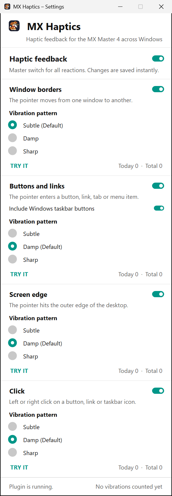

# MX Haptics

A Logi Options+ plugin that gives the **MX Master 4** haptic feedback across Windows:

| Reaction | When | Default pattern |
| --- | --- | --- |
| Window borders | the pointer moves from one window to another | Subtle |
| Buttons and links | the pointer enters a button, link, tab or menu item, or a Windows 11 taskbar button | Damp |
| Screen edge | the pointer hits the outer edge of the desktop (edges between monitors don't count) | Damp |
| Click | left or right click on an element that *Buttons and links* reacts to (clicks into text or on the desktop don't vibrate) | Damp |

Windows only. The plugin runs inside Logi Plugin Service; its settings live in a separate window.

> Unofficial project, not affiliated with, endorsed by, or supported by Logitech. Logitech, Logi, Logi Options+,
> MX and MX Master are trademarks of Logitech; they are used here only to describe what the plugin works with.
>
> Neoficiální projekt, není spojen s Logitech, Logitechem schválen ani podporován. Logitech, Logi, Logi Options+,
> MX a MX Master jsou ochranné známky společnosti Logitech; v tomto projektu slouží jen k popisu, s čím plugin funguje.

Building from source: [BUILDING.md](BUILDING.md). Contributing: [CONTRIBUTING.md](CONTRIBUTING.md).

## Installation

1. You need Logi Options+ and the [.NET 10 Desktop Runtime](https://dotnet.microsoft.com/download/dotnet/10.0)
   (`winget install Microsoft.DotNet.DesktopRuntime.10`).
2. Download `MxHaptics_<version>.lplug4` from [Releases](https://github.com/mpeterka/mx-haptics/releases) and double-click it.
   Logi Plugin Service asks for confirmation and installs the plugin.
3. In Options+ open the MX Master 4 → *Haptic feedback* → *Enable haptic for app plugins* and make sure **MX Haptics** is on.
4. Optional: a Start menu shortcut for the settings window. From a clone of this repository run
   `pwsh tools/Install-StartMenuShortcut.ps1 -Target "$env:LOCALAPPDATA\Logi\LogiPluginService\Plugins\MxHaptics\settings\MxHapticsSettings.exe"`.

## Settings

<picture>
  <source media="(prefers-color-scheme: dark)" srcset="docs/screenshots/settings-dark.png">
  
</picture>

### Opening the window

- **Mouse button or Actions Ring:** in Logi Options+ open the MX Master 4, pick a button (or the Actions Ring)
  and choose **MX Haptics → MX Haptics settings** among the installed plugin actions.
- **Start menu:** type "MX Haptics" and run *MX Haptics Settings* (if you created the shortcut).
- **Directly:** `%LOCALAPPDATA%\Logi\LogiPluginService\Plugins\MxHaptics\settings\MxHapticsSettings.exe`.

Only one window runs at a time; starting it again brings the open window to the front. *Esc* closes it.

### What you can set

- turn all haptics on or off (*Haptic feedback*),
- turn each reaction on or off,
- for *Buttons and links*, include or skip Windows taskbar buttons (*Include Windows taskbar buttons*),
- pick the vibration pattern of each reaction: *Subtle*, *Damp* or *Sharp*; picking one vibrates right away,
- feel a reaction with *Try it* (works even when the reaction is off).

Each reaction shows how many vibrations it sent today and in total (*Try it* doesn't count).

Changes are saved instantly and the plugin picks them up without a restart. The window follows the Windows light or dark mode.
When the plugin isn't running, the footer says so in orange and the settings apply once it starts.

### Vibration pattern vs. Haptic intensity

*Haptic intensity* in Options+ (Subtle / Low / Medium / High) sets how strongly the mouse motor vibrates, for everything.
A plugin can't choose a strength, only which vibration pattern to play. So *Subtle*, *Damp* and *Sharp* in this window
pick the pattern, and the Options+ intensity scales all of them.

### Other controls

- **The whole plugin:** Options+ → MX Master 4 → *Haptic feedback* → *Enable haptic for app plugins* → MX Haptics.
  With this switch off the mouse doesn't vibrate even though the plugin runs.
- **Overall vibration strength:** *Haptic intensity* in the same panel (applies to everything, not just this plugin).
- **Quick toggle:** assign the *Toggle MX Haptics* action to a button; it flips the master switch.

## Troubleshooting

- **MX Haptics isn't among the plugin actions or under *Enable haptic for app plugins*:** use *Restart Logi Plugin Service*
  in the Options+ settings.
- **No vibration at all:** check *Enable haptic for app plugins* → MX Haptics and the *Haptic feedback* switch in both
  Options+ and the MX Haptics window. *Try it* tells you whether the mouse can vibrate for the plugin at all.
- **Some app's buttons don't vibrate:** the app doesn't expose accessibility information (some games and Electron apps).
  The plugin has no other way to find its buttons.
- **The settings window says the plugin isn't running:** restart Logi Plugin Service. The plugin log is
  `%LOCALAPPDATA%\Logi\LogiPluginService\Logs\plugin_logs\MxHaptics.log`.

## Uninstalling

In Options+ open *Haptic feedback* → *Enable haptic for app plugins* → *Install and uninstall plugins* and remove MX Haptics.
Settings and vibration counts stay in `%LOCALAPPDATA%\MxHaptics`; delete that folder to remove them too.
`pwsh tools/Install-StartMenuShortcut.ps1 -Remove` deletes the Start menu shortcut.

## Privacy

The plugin reads the pointer position, mouse button state and the type and position of the UI element under the pointer
(not its text). It stores only your settings and per-day vibration counts in `%LOCALAPPDATA%\MxHaptics`. It sends nothing
over the network.

## License

[MIT](LICENSE)
