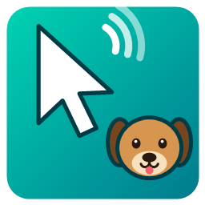
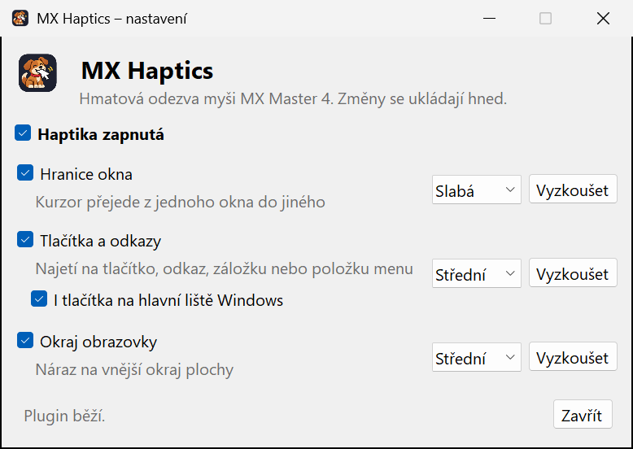
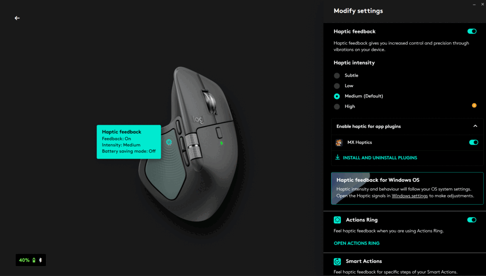

# MX Haptics



Plugin pro Logi Options+ (Logi Actions SDK), který posílá hmatovou odezvu na myš **MX Master 4**:

| Reakce | Kdy | Výchozí síla |
| --- | --- | --- |
| Hranice okna (`windowBorder`) | kurzor přejede z jednoho okna do jiného | slabá |
| Tlačítka a odkazy (`controlHover`) | najetí na tlačítko, odkaz, záložku, položku menu (MSAA), tlačítka hlavní lišty Windows 11 (UI Automation) | střední |
| Okraj obrazovky (`screenEdge`) | náraz na vnější okraj plochy (vnitřní hrany monitorů se nepočítají) | střední |

Jen Windows. Plugin běží uvnitř Logi Plugin Service, nastavení má samostatné okno.

> Neoficiální projekt, není spojen s Logitech, Logitechem schválen ani podporován. Logitech, Logi, Logi Options+,
> MX a MX Master jsou ochranné známky společnosti Logitech; v tomto projektu slouží jen k popisu, s čím plugin funguje.
>
> Unofficial project, not affiliated with, endorsed by, or supported by Logitech. Logitech, Logi, Logi Options+,
> MX and MX Master are trademarks of Logitech; they are used here only to describe what the plugin works with.

## Instalace

1. Potřeba je Logi Options+ a [.NET 10 Desktop Runtime](https://dotnet.microsoft.com/download/dotnet/10.0)
   (`winget install Microsoft.DotNet.DesktopRuntime.10`).
2. Z [Releases](https://github.com/mpeterka/mx-haptics/releases) stáhni `MxHaptics_<verze>.lplug4` a dvakrát na něj klikni.
   Logi Plugin Service se zeptá na instalaci a plugin nainstaluje do `%LOCALAPPDATA%\Logi\LogiPluginService\Plugins\MxHaptics`.
3. Zástupce okna nastavení do nabídky Start (volitelné):
   `pwsh tools/Install-StartMenuShortcut.ps1 -Target "$env:LOCALAPPDATA\Logi\LogiPluginService\Plugins\MxHaptics\settings\MxHapticsSettings.exe"`

Balíček se nekombinuje s vývojovou instalací z [Sestavení](#sestavení): před instalací `.lplug4` smaž `MxHaptics.link`.
Release se sestavuje ručně (viz [Vydání verze](#vydání-verze)), GitHub Actions to neumí: build potřebuje `PluginApi.dll`
z nainstalovaného Logi Options+, který na runneru není.

## Nastavení

<picture>
  <source media="(prefers-color-scheme: dark)" srcset="docs/screenshots/nastaveni-dark.png">
  
</picture>

### Jak okno otevřít

1. **Nabídka Start:** napiš „MX Haptics“ a spusť *MX Haptics – nastavení*.
   Zástupce vytvoří `pwsh tools/Install-StartMenuShortcut.ps1` (smaže ho `-Remove`).
2. **Tlačítkem myši nebo z Actions Ringu:** v Logi Options+ otevři MX Master 4, vyber tlačítko (nebo Actions Ring)
   a v akcích nainstalovaných pluginů zvol **MX Haptics → Nastavení MX Haptics**. Pokud tam MX Haptics není,
   dej v nastavení Options+ *Restart Logi Plugin Service*.
3. **Přímo:** `build\settings\MxHapticsSettings.exe`.

Okno běží vždy jen jednou. Další spuštění přenese otevřené okno do popředí.

### Co jde nastavit

V okně můžeš:

- celou haptiku zapnout nebo vypnout,
- každou reakci zvlášť zapnout nebo vypnout,
- u reakce *Tlačítka a odkazy* vypnout tlačítka na hlavní liště Windows (*I tlačítka na hlavní liště Windows*),
- zvolit sílu reakce: slabá (`subtle_collision`), střední (`damp_collision`), silná (`sharp_collision`),
- tlačítkem *Vyzkoušet* si vibraci hned ohmatat (funguje i u vypnuté reakce).

Změny se ukládají hned do `%LOCALAPPDATA%\MxHaptics\settings.json` a plugin je načte bez restartu.

Okno se řídí světlým nebo tmavým režimem Windows. Když plugin neběží, napíše to oranžově ve spodní liště
a nastavení se použije po jeho spuštění.

### Další ovládání

- **Celý plugin:** Options+ → MX Master 4 → *Haptic feedback* → *Enable haptic for app plugins* → MX Haptics.
  Když je přepínač vypnutý, myš nevibruje, ani když plugin běží.
- **Celková síla vibrací myši:** *Haptic intensity* ve stejném panelu (platí pro všechno, nejen pro tenhle plugin).


- **Rychlé vypnutí:** akce *Zapnout/vypnout MX Haptics* přepíná hlavní vypínač.

SDK neumí poslat vibraci se zvolenou silou. Proto má každá reakce tři události (`windowBorder_weak`, `_medium`, `_strong`)
s různými vzory v [`eventMapping.yaml`](src/package/events/extra/eventMapping.yaml) a plugin posílá tu zvolenou.

## Sestavení

Potřeba [.NET 10 SDK](https://dotnet.microsoft.com/download/dotnet/10.0) (`winget install Microsoft.DotNet.SDK.10`;
obsahuje i Windows Desktop Runtime pro okno nastavení) a nainstalované Logi Options+.
`PluginApi.dll` se bere z `C:\Program Files\Logi\LogiPluginService`.

```powershell
dotnet build src/MxHapticsPlugin.csproj
```

Build složí plugin do `build/` (`metadata/`, `events/`, `win/`), přeloží okno nastavení do `build/settings/` a zapíše
`%LOCALAPPDATA%\Logi\LogiPluginService\Plugins\MxHaptics.link`, takže ho Logi Plugin Service načte přímo odtud.
Pokud se plugin neobjeví, dej v nastavení Options+ *Restart Logi Plugin Service*.
Logy: `%LOCALAPPDATA%\Logi\LogiPluginService\Logs\plugin_logs\MxHaptics.log`.

**Odinstalace:** smazat `MxHaptics.link`, restartovat Logi Plugin Service a případně smazat `%LOCALAPPDATA%\MxHaptics`.

### Vydání verze

Zvyš `version` v [`LoupedeckPackage.yaml`](src/package/metadata/LoupedeckPackage.yaml), pak:

```powershell
dotnet tool install --global LogiPluginTool   # jednou
Remove-Item build -Recurse -Force             # ať v balíčku nezůstanou .pdb z vývojového buildu
dotnet build src/MxHapticsPlugin.csproj -c Release -p:SkipPluginLink=true   # Release je bez .pdb (DebugType=none v csproj)
logiplugintool pack ./build ./MxHaptics_<verze>.lplug4
logiplugintool verify ./MxHaptics_<verze>.lplug4
gh release create v<verze> ./MxHaptics_<verze>.lplug4 --title "MX Haptics <verze>" --notes "…"
```

## Jak to funguje

- Vlákno oken a okrajů každých 10 ms čte polohu kurzoru. Hranici okna hlásí, když se změní kořenové okno pod kurzorem
  a vydrží aspoň dva vzorky (filtruje probliknutí tooltipů). Okraj plochy hlásí, když sousední pixel neleží na žádném monitoru.
- Vlákno prvků každých 30 ms (jen při pohybu a bez stisknutého tlačítka) zjistí přes MSAA (`AccessibleObjectFromPoint`)
  prvek pod kurzorem a projde pár úrovní rodičů. Vibruje při vstupu na nový prvek s rolí tlačítko, odkaz, záložka, položka menu,
  zaškrtávátko, přepínač nebo rozbalovací seznam.
- Hlavní lišta Windows 11 je pro MSAA jeden blok bez tlačítek. Když je kurzor nad lištou (`Shell_TrayWnd`, na dalších monitorech
  `Shell_SecondaryTrayWnd`), plugin si přes UI Automation načte obdélníky jejích tlačítek (aplikace, Start, ikony v oznamovací
  oblasti, hodiny …), drží je sekundu v cache a kurzor s nimi porovnává sám.
- Okno nastavení posílá pluginu příkazy přes lokální pojmenovanou rouru `MxHaptics` (jen pro aktuálního uživatele):
  `reload` po uložení a `test <reakce> <síla>` pro tlačítko *Vyzkoušet*.
- Aplikace, které neposkytují accessibility (některé hry, část Electron aplikací), na tlačítkách vibrovat nebudou.

## Ikona

Zdroj ve vysokém rozlišení je [`design/icon-source.png`](design/icon-source.png). Plugin používá jeho zmenšeninu
`src/package/metadata/Icon256x256.png` (256 × 256 px). Exe okna nastavení a zástupce používají `design/icon.ico`,
který z PNG vyrobí `pwsh tools/Convert-IconToIco.ps1`.

## Screenshoty

Screenshoty okna v `docs/screenshots/` se generují bez klikání. Okno se vykreslí s výchozím nastavením, nic neuloží a zavře se:

```powershell
build\settings\MxHapticsSettings.exe --screenshot docs\screenshots\nastaveni-dark.png --theme dark
build\settings\MxHapticsSettings.exe --screenshot docs\screenshots\nastaveni-light.png --theme light
```

## Licence

[MIT](LICENSE)
